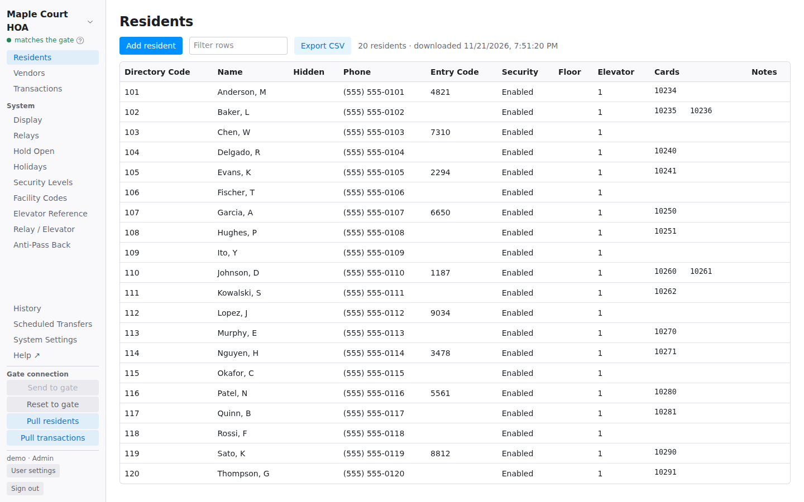
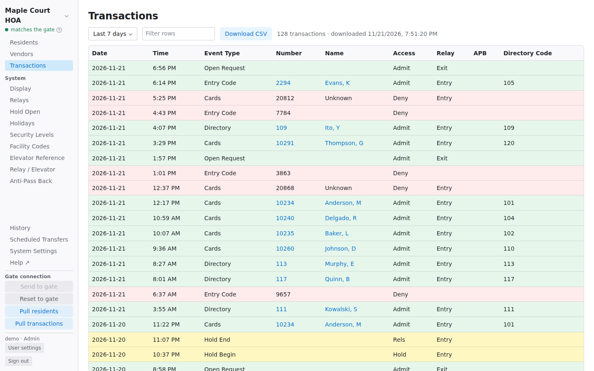
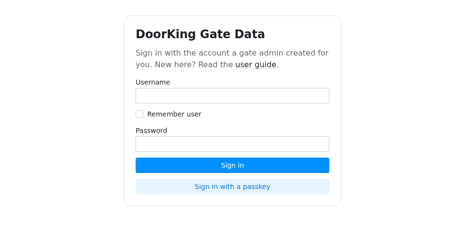

# DoorKing Gate Manager

A self-hosted web app that manages DoorKing telephone-entry gate systems through DKS Cloud, as a replacement for
the discontinued DoorKing32 desktop app.

It pulls residents and transactions from the gate, lets you edit residents, vendors and gate settings in a working
copy, and sends the changes back. It can also control the gate's relays live and save camera pictures or video
for each transaction from a Dahua or Amcrest recorder. It runs on Node.js 24 with PostgreSQL, has a React web page
that works on phones and installs as an app, and a REST API for scripts.

> **Sending and relay control change the physical gate.** A relay set to Active holds the gate open until it is set
> back to Inactive.

## Screenshots

The screenshots use made-up sample data (a demo gate "Maple Court HOA", fictional names and 555-01xx numbers).

| Residents | Transactions |
|---|---|
|  |  |



## Features

- **Residents and vendors**: directory codes, names, phone numbers, entry codes, cards, security levels, floors and
  local notes. Duplicates are flagged, and a send is refused until they are fixed. Export in DoorKing's cloud CSV format.
- **Gate settings**: display messages, relays, hold-open schedules, holidays, security levels, facility codes,
  elevators and anti-passback.
- **Working copy**: every edit stays here until **Send to gate**. A send uploads only the changed blocks, then pulls
  the residents again to check that the gate holds them. Changes made at the gate in the meantime show as conflicts.
- **Transactions**: the full history, kept after events roll out of the gate's buffer, with names, filters and
  CSV download.
- **Live relays**: read the gate's relays and open or release them, including Tracker expansion relays.
- **Cameras**: pictures or 2-minute videos of each transaction from a Dahua/Amcrest recorder, reached by serial
  number through Dahua's P2P cloud (no port forwarding), optional per-channel relay associations (`channels[].relays`) so each transaction only captures cameras covering the triggered entrance, and a live view.
- **Scheduled transfers**: send, pull residents, pull transactions and get camera footage on set days and times.
- **People and access**: local accounts, passkeys, push-notification passkey approval with 2-digit number matching and Android Keystore ECDSA P-256 biometric verification, single sign-on (OpenID Connect: Microsoft Entra ID, Google Workspace and others), admin/editor/read-only/resident roles per gate, email invitations, password resets, Web Push / FCM notifications and alerts.
- **Resident Self-Service Portal & MCP**: "Buzz Me In" momentary relay pulse (including admin all-relay access and per-user `hiddenRelays`), daily-capped entry code rerolling, unit activity feed with suspicious-event reporting, self-service change requests, and delegated MCP / AI client bearer sessions (`POST /api/session/mint-bearer`, manageable under Connected AI Clients).
- **History**: who changed what, with before and after values, and Revert.
- **Phones**: a phone layout with tab bar and cards, and installation as an app (PWA).
- **REST API**: per-gate API keys, an OpenAPI 3.1 spec and a Swagger UI page.

## Requirements

- Node.js 24 or later
- PostgreSQL 14 or later
- A DKS Cloud account, and for each gate its system phone number and 4-digit master code
- ffmpeg, only for cameras

Windows and Linux are both supported. [INSTALL.md](docs/INSTALL.md) has the details.

## Quick start

```sh
git clone https://github.com/rouing/doorking-webui.git
cd doorking-webui
cp config.example.json config.json   # set database.password to a long random password
chmod 600 config.json
npm install
node cli.ts db-setup                 # asks for a PostgreSQL admin URL; creates the login, database and schema
npm run build
npm start
```

Open <http://localhost:8080>. To create the first account, enter the one-time **setup code** the server printed in
its console when it started. Then add a gate with its system phone number, master code and DKS login. The gate is
added only after a residents pull with those values works.

For running it as a service, public access over HTTPS (needed for passkeys and installing the app), single
sign-on, email, updates and backups, see [INSTALL.md](docs/INSTALL.md).

## Usage

- **Web page**: everything is done from the gate's pages. The [user guide](docs/MANUAL.md) is also in the app under
  **Help**.
- **REST API**: create a key under System Settings → API keys and send it as `Authorization: Bearer <key>`.
  ```sh
  curl -H "Authorization: Bearer $KEY" http://localhost:8080/api/gates/5550100/residents
  ```
  Routes are in [API.md](docs/API.md); the spec is at `/api/openapi.json` and Swagger UI at `/api/docs`.
- **Command-line tool**: `node cli.ts` lists its commands: `create-admin`, `reset-password`, `grant`, `test-email`,
  `sso-check`, `emails`, DKS Cloud pulls, and readers for DoorKing's local files.

## Documentation

| File | For | Contents |
|---|---|---|
| [INSTALL.md](docs/INSTALL.md) | whoever sets it up | requirements, install, `config.json` settings, running as a service, HTTPS, single sign-on, updates, backups, troubleshooting |
| [MANUAL.md](docs/MANUAL.md) | users | the user guide, in plain language |
| [API.md](docs/API.md) | scripts | the REST API |
| [ARCHITECTURE.md](docs/ARCHITECTURE.md) | developers | how it works: sign-in, the pages, data storage, cameras, logging, data flow, security, project layout |
| [DB.md](docs/DB.md) | developers | the database, encryption and every table |
| [BITMAP.md](docs/BITMAP.md) | developers | which bytes of the gate's board files hold which setting |

## Development

```sh
npm run dev         # the page with hot reload on :5173; /api goes to the server on :8080
npm run typecheck   # server and page
npm test            # node --test; needs the doorking_test database (node cli.ts db-setup --test-db)
```

The server runs its TypeScript directly on Node 24, so it has no build step. Only the page is built (Vite).
[ARCHITECTURE.md](docs/ARCHITECTURE.md#project-layout) describes every folder and file.

## Security

- The server listens on `127.0.0.1` only. Public access goes through an HTTPS reverse proxy such as Caddy.
- DKS logins, master codes, recorder passwords and the gate files are encrypted with AES-256-GCM in the database.
  The key is `doorking.key`, beside `config.json`. Keep both private: with the database they reveal the master codes.
- Passwords are scrypt hashes. Sessions and API keys are stored only as SHA-256 hashes. Failed sign-ins are rate
  limited.
- Sending to the gate, managing users, API keys and the gate's login need a recent passkey, hardware biometric key (`biometric_keys`), or MFA SSO confirmation.

The details are in [ARCHITECTURE.md](docs/ARCHITECTURE.md#security).

## Roadmap

- Push notifications to the installed app for failed sends and scheduled transfers, next to the email alerts.

## Disclaimer

This is an independent project. It is not affiliated with, endorsed by or supported by DoorKing, Inc. DoorKing,
DKS and DoorKing32 are names of DoorKing, Inc., used here only to say what the app works with. The repository
contains none of DoorKing's software or documentation.

## License

MIT. See [LICENSE](LICENSE).
